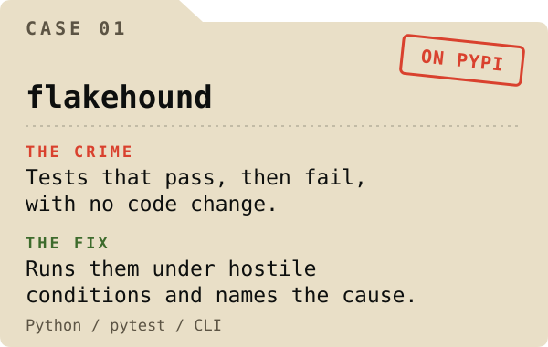
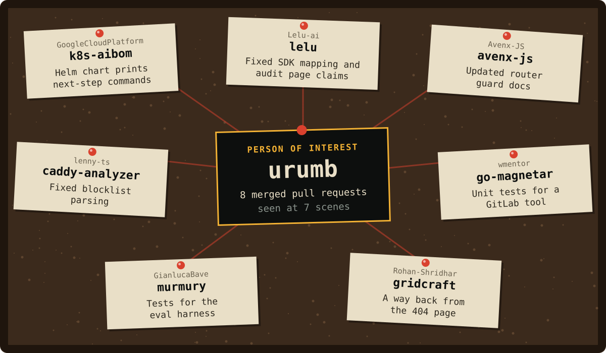
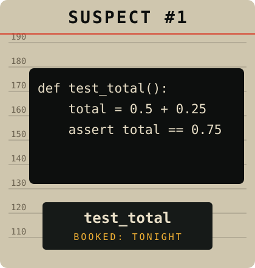
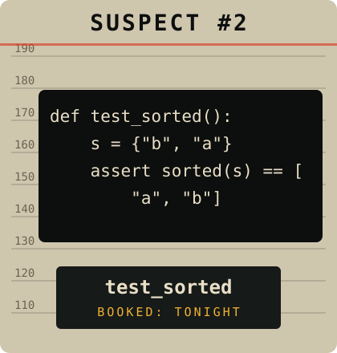
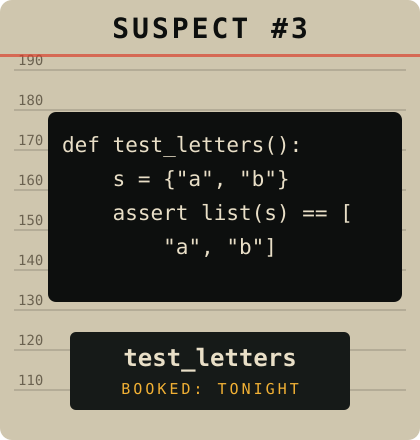

<code>pip install flakehound</code>&nbsp; · &nbsp;<a href="https://pypi.org/project/flakehound/">PyPI</a>&nbsp; · &nbsp;<a href="mailto:noeljacobantony99@gmail.com">send a tip</a>&nbsp; · &nbsp;<a href="https://buymeacoffee.com/urumb">buy the hound a coffee</a>

 

Click a file to open it. Source: <a href="https://github.com/urumb/flakehound">flakehound</a> · <a href="https://github.com/urumb/multi-agent-code-auditor">auditor</a> · <a href="https://github.com/urumb/submission-doctor">doctor</a> · <a href="https://github.com/urumb/brandproof">brandproof</a> (Team Maverick, CodeNova India 2026) · <a href="https://github.com/urumb/loan-risk-platform">credishield</a> · <a href="https://github.com/urumb/hushroom">hushroom</a>

 

📂 <b>Open the evidence</b> (links to each merged pull request)

 

| Scene | What I left behind |
| :-- | :-- |
| **GoogleCloudPlatform/k8s-aibom** | [Helm chart prints next-step commands after install](https://github.com/GoogleCloudPlatform/k8s-aibom/pull/406) |
| **Lelu-ai/lelu** | [Fixed response mapping in the TypeScript SDK](https://github.com/Lelu-ai/lelu/pull/130) · [Corrected audit page claims](https://github.com/Lelu-ai/lelu/pull/141) |
| **Avenx-JS/avenx-js** | [Updated router guard docs](https://github.com/Avenx-JS/avenx-js/pull/1777) |
| **lenny-ts/caddy-analyzer** | [Fixed blocklist parsing with trailing comments](https://github.com/lenny-ts/caddy-analyzer/pull/151) |
| **wmentor/go-magnetar** | [Added unit tests for a GitLab tool](https://github.com/wmentor/go-magnetar/pull/385) |
| **GianlucaBave/murmury** | [Added tests for the eval harness](https://github.com/GianlucaBave/murmury/pull/94) |
| **Rohan-Shridhar/gridcraft** | [Added a way back from the 404 page](https://github.com/Rohan-Shridhar/gridcraft/pull/151) |

 

Things confiscated after midnight. All of them are clickable.

- 💨 [**FARTLE**](https://urumb.github.io/fartle/): a daily word ladder that always ends in one place
- ⏪ [**One Second Ago**](https://github.com/urumb/one-second-ago): rewind yourself, but the world doesn't
- 🌍 [**Live Threat Map**](https://urumb.github.io/DDOS-attack-map/): a 3D globe of *simulated* cyber attacks
- ⌨️ [**Typing Test**](https://urumb.github.io/typing-test/): how fast are your fingers?
- 📸 [**Polaroid**](https://urumb.github.io/polaroid/): a little Polaroid experiment
- 🍩 [**Donut Factory**](https://urumb.github.io/donut/): a bakery page with a bitable donut cursor

 

One of these three tests is lying. It can pass on one run and fail on the next. **Pick the culprit.**

👉 <b>Accuse suspect #1</b>

 

❌ **Wrong. Released without charge.** Floats look guilty, but 0.5, 0.25 and 0.75 are all exact in binary. This one passes every time.

👉 <b>Accuse suspect #2</b>

 

❌ **Wrong. Solid alibi.** A set has no promised order, but `sorted()` gives it one before the comparison.

👉 <b>Accuse suspect #3</b>

 

🚨 **Guilty.** Python randomises string hashing in each new process, so `list(s)` can come out as `['b', 'a']`. Setting `PYTHONHASHSEED` pins the behaviour down.

[**flakehound**](https://github.com/urumb/flakehound) catches this kind of liar for you.

 

**Known associates:** Python, Java, C, C++, JavaScript, TypeScript · Flask, Django, React, Next.js · TensorFlow, PyTorch, scikit-learn, NumPy, Pandas · PostgreSQL, MySQL, SQLite, Prisma

**Currently investigating:** advanced ML, backend system design and real-world deployment

**Open to:** AI/ML projects, open source and student-led tech initiatives

 

