<div align="center">

<a href="#battle"></a>

<a href="#stats">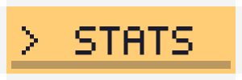</a>
<a href="#quests">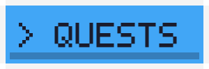</a>
<a href="#battle">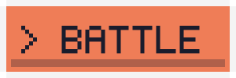</a>
<a href="#arcade">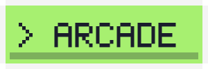</a>

</div>

<br />

<a name="stats"></a>


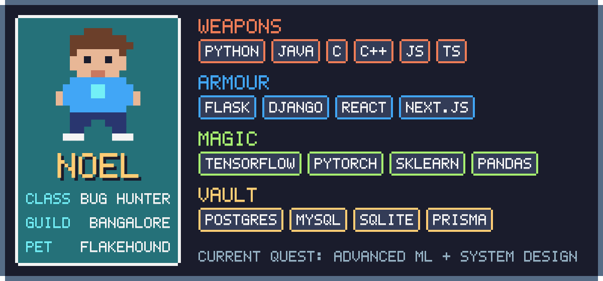

<br />

<a name="quests"></a>


<div align="center">

<a href="https://github.com/urumb/flakehound">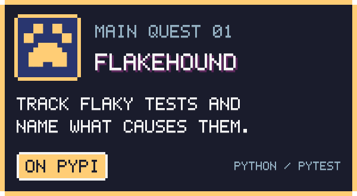</a>
<a href="https://github.com/urumb/multi-agent-code-auditor">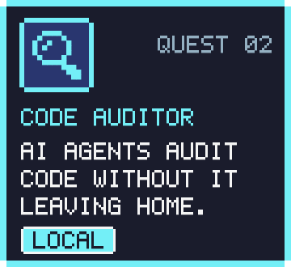</a>
<a href="https://urumb.github.io/submission-doctor/">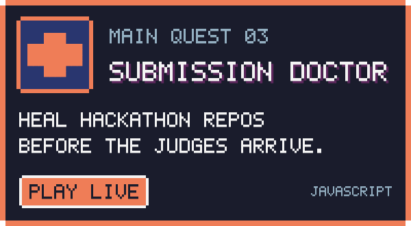</a>
<a href="https://brandproof-wff4.onrender.com/">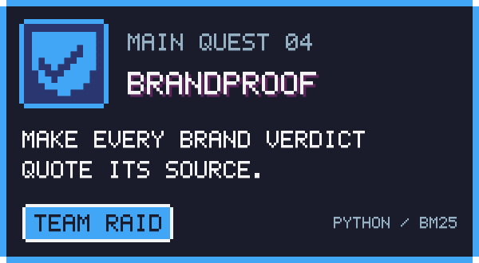</a>
<a href="https://credishield-lyart.vercel.app">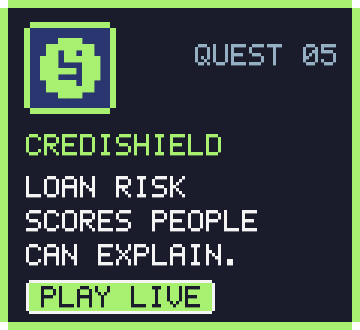</a>
<a href="https://urumb.github.io/hushroom/">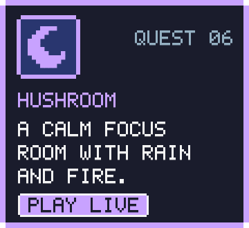</a>

<sub>Pick a quest to open it. Source code: <a href="https://github.com/urumb/flakehound">flakehound</a> · <a href="https://github.com/urumb/multi-agent-code-auditor">auditor</a> · <a href="https://github.com/urumb/submission-doctor">doctor</a> · <a href="https://github.com/urumb/brandproof">brandproof</a> (Team Maverick, CodeNova India 2026) · <a href="https://github.com/urumb/loan-risk-platform">credishield</a> · <a href="https://github.com/urumb/hushroom">hushroom</a></sub>

</div>

<br />



<details>
<summary>📜 <b>Read the quest log</b> (links to each merged pull request)</summary>
<br />

| Realm | Deed |
| :-- | :-- |
| **GoogleCloudPlatform/k8s-aibom** | [Helm chart prints next-step commands after install](https://github.com/GoogleCloudPlatform/k8s-aibom/pull/406) |
| **Lelu-ai/lelu** | [Fixed response mapping in the TypeScript SDK](https://github.com/Lelu-ai/lelu/pull/130) · [Corrected audit page claims](https://github.com/Lelu-ai/lelu/pull/141) |
| **Avenx-JS/avenx-js** | [Updated router guard docs](https://github.com/Avenx-JS/avenx-js/pull/1777) |
| **lenny-ts/caddy-analyzer** | [Fixed blocklist parsing with trailing comments](https://github.com/lenny-ts/caddy-analyzer/pull/151) |
| **wmentor/go-magnetar** | [Added unit tests for a GitLab tool](https://github.com/wmentor/go-magnetar/pull/385) |
| **GianlucaBave/murmury** | [Added tests for the eval harness](https://github.com/GianlucaBave/murmury/pull/94) |
| **Rohan-Shridhar/gridcraft** | [Added a way back from the 404 page](https://github.com/Rohan-Shridhar/gridcraft/pull/151) |

</details>

<br />

<a name="battle"></a>


**Your turn.** A test passes alone and fails in the full suite. Open a move to play it.


<details>
<summary>🔁 <b>MOVE 1: Hit retry</b></summary>
<br />


The bug is still there. Close this move and try another.

</details>

<details>
<summary>💤 <b>MOVE 2: Add sleep(5)</b></summary>
<br />


Waiting does not fix leaked state. Close this move and try another.

</details>

<details>
<summary>🐕 <b>MOVE 3: Send in the hound</b></summary>
<br />


**Critical hit!** Now finish it.

<blockquote>

<details>
<summary>✨ <b>FINISHER A: Reset the cart before every test</b></summary>
<br />


🏆 **You won.** Take the same hound into your own project:

```bash
pip install flakehound
flakehound run
```

</details>

<details>
<summary>🗑️ <b>FINISHER B: Delete the failing test</b></summary>
<br />


💀 **Game over.** Close this and pick the other finisher.

</details>

</blockquote>

</details>

<br />

<a name="arcade"></a>


Mini games and side projects. These ones really are playable.

| | |
| :-- | :-- |
| 💨 [**FARTLE**](https://urumb.github.io/fartle/)<br />A daily word ladder that always ends in one place | ⏪ [**One Second Ago**](https://github.com/urumb/one-second-ago)<br />Rewind yourself, but the world doesn't |
| 🌍 [**Live Threat Map**](https://urumb.github.io/DDOS-attack-map/)<br />A 3D globe of *simulated* cyber attacks | ⌨️ [**Typing Test**](https://urumb.github.io/typing-test/)<br />How fast are your fingers? |
| 📸 [**Polaroid**](https://urumb.github.io/polaroid/)<br />A little Polaroid experiment | 🍩 [**Donut Factory**](https://urumb.github.io/donut/)<br />A bakery page with a bitable donut cursor |

<br />

<a href="mailto:noeljacobantony99@gmail.com"></a>

<div align="center">

<a href="https://pypi.org/project/flakehound/">PyPI</a> · <a href="mailto:noeljacobantony99@gmail.com">Email</a> · <a href="https://buymeacoffee.com/urumb">Buy the hound a coffee</a><br />
<sub>Open to AI/ML projects, open source and student-led tech initiatives.</sub>

</div>
